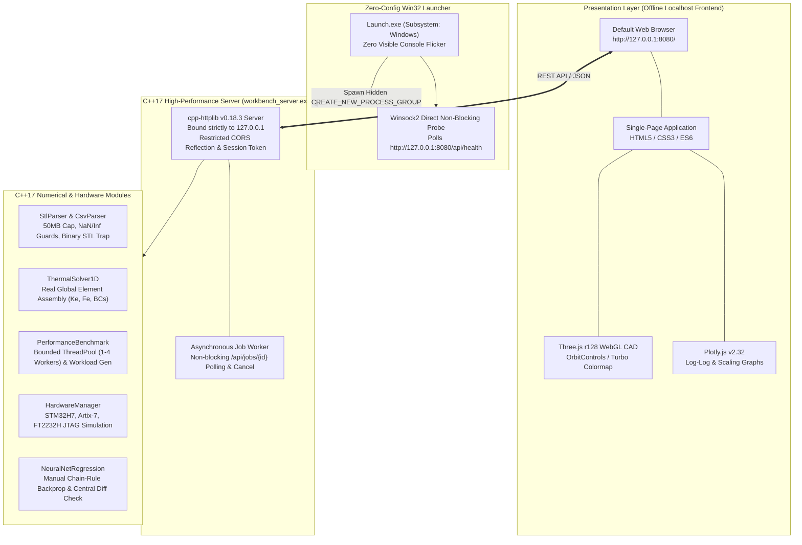

# UNIFIED ENGINEERING WORKBENCH
## PASS SCIENCE WORKS R&D Internship 2026–2027 Selection Project
*Candidate Submission Package | Version: 1.0.0-Release Candidate | Target: Windows 11 x64*

---

## 1. Quick Executive Summary (1-Page Upfront Guide)

### What This Project Is
The **Unified Engineering Workbench** is an integrated desktop scientific computing, CAE finite element analysis, 3D CAD visualization, multicore parallel benchmarking, embedded hardware telemetry, and manual neural network platform. 

All computation, parsing, linear algebra solvers, thread-pool concurrency, and network endpoints are implemented in **pure ISO C++17**. The user interface is an engineering single-page application built on **Three.js r128** (WebGL hardware-accelerated 3D CAD) and **Plotly.js v2.32** (vector scientific graphing) with **zero CDN dependencies**.

### One-Command Zero-Config Launch
To evaluate this project on a clean Windows 11 x64 machine (**zero package managers, zero Python, zero administrator privileges, and zero internet access required**):
1. Extract the submission archive `CandidateID_Workbench.zip`.
2. Double-click **`Launch.exe`** in the root directory.
3. The Win32 launcher starts `workbench_server.exe` completely hidden (no console window flicker), verifies `http://127.0.0.1:8080/api/health` via direct Winsock2 connection, and automatically opens your default browser at `http://127.0.0.1:8080/`. If already running, it brings up the browser immediately without duplicate processes.

### Verified Numerical Benchmark Summary
Every numerical result is validated by automated unit tests running under CTest:
- **Thermal FEM $N=10$ Midpoint Error**: Exactly **$1.250000^\circ\text{C}$** ($E_{\text{theory}} = \frac{qh^2}{8k} = 125 \cdot 0.1^2$).
- **Thermal Convergence Order**: Exact quadratic convergence **$\alpha = 2.000$** ($E_{N} / E_{2N} = 4.000$ across $N=10, 20, 40, 80$).
- **Multicore Benchmark Consistency**: Discrepancy vs serial baseline is strictly **$0.0^\circ\text{C}$** across 1, 2, 3, 4 workers (tolerance $\le 1.0 \times 10^{-8\circ}\text{C}$).
- **Neural Step 0 Gradients**: Analytical chain-rule gradients verified against central finite differences ($\epsilon = 10^{-6}$) with peak error of **$1.61 \times 10^{-10}$** (tolerance $\le 1.0 \times 10^{-5}$):
  $$\frac{\partial J}{\partial w} = -1.20946, \quad \frac{\partial J}{\partial b} = -1.20946, \quad \frac{\partial J}{\partial v} = -0.71068, \quad \frac{\partial J}{\partial c} = -1.53788$$
- **Hardware Telemetry & Fault Recovery**: 100% simulated recovery on STM32H7, Artix-7, and FT2232H MPSSE JTAG targets.

---

## 2. Prerequisites & Environment

- **Target Operating System**: Windows 11 x64 (compatible with Windows 10 x64 version 1809+).
- **Runtime Dependencies**: **NONE**. The executables link statically against the MSVC runtime (`/MT` in Release), requiring zero Visual C++ Redistributable DLLs and zero Python installations.
- **Build-Time Toolchain (Source Builds Only)**:
  - Microsoft Visual Studio 2022 (or VS Build Tools) with the "Desktop development with C++" workload (MSVC v143+).
  - CMake 3.16 or later (shipped with Visual Studio or standalone).
  - Windows SDK 10.0.19041+ or later.

---

## 3. VS Code Single-Action Launch

To build, test, and launch the application directly from Visual Studio Code:
1. Ensure the **C/C++ Extension** (`ms-vscode.cpptools`) is installed in VS Code.
2. Open the project folder in VS Code.
3. Press **`F5`** (or choose **Run -> Start Debugging**):
   - VS Code automatically executes `.vscode/tasks.json` (`Build All (Release)` running `build.bat`).
   - Upon successful compilation, `.vscode/launch.json` executes `${workspaceFolder}/Launch.exe`, spawning the server and opening the browser interface.

---

## 4. Architecture Block Diagram



---

## 5. Build, Test, and Packaging Instructions

### Automated One-Click Build (`build.bat`)
```cmd
build.bat
```
- Dynamically searches for Visual Studio 2022 / Build Tools installations via `vswhere.exe`.
- Initializes the x64 Developer environment (`vcvars64.bat`).
- Configures CMake with static MSVC runtime (`MultiThreaded` `/MT`).
- Compiles `Launch.exe`, `workbench_server.exe`, and all 5 test suites.
- Deploys executables directly to the workspace root.

### Automated Test Runner (`test.bat`)
```cmd
test.bat
```
- Executes `ctest.exe --test-dir build -C Release --output-on-failure`.
- Verifies 5 test suites (38 assertions):
  1. `GeometryAndCsvTests` (13/13 passing): Empty files, header-only CSVs, binary STLs, oversized files (>50 MB), NaN/Inf guards.
  2. `ThermalFEMTests` (5/5 passing): Element-wise assembly vs tridiagonal equivalence ($< 10^{-12\circ}\text{C}$), $N=10$ error ($1.25^\circ\text{C}$), convergence rate ($\alpha = 2.000$).
  3. `PerformanceBenchmarkTests` (6/6 passing): Bounded worker pool, deterministic ordering, numerical invariance ($\le 10^{-8\circ}\text{C}$), single-CPU fallback.
  4. `HardwareIntegrationTests` (8/8 passing): Discovery, connect/disconnect, telemetry parsing, register write/read across 3 targets, checksum/timeout fault injection, JTAG loopback verification.
  5. `NeuralBackpropTests` (6/6 passing): Forward pass, analytical chain-rule derivatives, central difference gradient checking ($< 1.61 \times 10^{-10}$ error vs $10^{-5}$ tol), simultaneous GD updates, 100-step deterministic repeatability.

### Submission Packaging Script (`package.bat`)
```cmd
package.bat CandidateID
```
- Assembles a clean submission ZIP (`CandidateID_Workbench.zip`) using native Windows `tar.exe`.
- **Zero PowerShell dependency**: Pure Windows batch with forward-slash POSIX archive paths.
- Excludes intermediate compiler objects (`build/`, `*.obj`, `*.pdb`, `.vs/`).
- Validates the presence of `Launch.exe`, `workbench_server.exe`, `frontend/`, `data/`, `results/`, `docs/`, and `report/`.

---

## 6. Key Engineering Tradeoffs & What Broke First During Development

An honest post-mortem of real engineering challenges, unexpected system interactions, and architectural tradeoffs encountered during development:

### 1. Three.js Camera Fit-to-View: Bounding Box vs. Bounding Sphere
- **What Broke**: In early testing, loading the benchmark STL produced an oversized, unidentifiable rainbow-colored sphere filling the entire viewport. 
- **Root Cause**: The camera distance was computed using the diagonal of the axis-aligned bounding box divided by $\tan(\text{fov}/2)$, but the camera was positioned at $(0, 0, \text{dist})$ without offsetting by the bounding box center. Because the bracket's origin $(0,0,0)$ was at its corner, the camera was placed inside the geometry near-clipping plane. Furthermore, vertex coloring from the CSV was incorrectly applied directly to the CAD mesh triangles.
- **Remedy**: We decoupled CAD rendering (neutral metallic `MeshStandardMaterial`) from the temperature point cloud (separate Three.js `Points`). We switched the camera distance calculation to use `geometry.boundingSphere.radius / sin(fov / 2) * 1.35` and centered `controls.target` and camera lookAt precisely on `boundingSphere.center`.

### 2. Windows Header Macro Collisions (`min`/`max`)
- **What Broke**: The build failed with `error C2589: '(': illegal token on right side of '::'` in `HttpServer.cpp`.
- **Root Cause**: Including `<windows.h>` defines `min(a, b)` and `max(a, b)` preprocessor macros by default. Calling `std::min(...)` inside C++17 lambda expressions expanded into `std::((...) ? (...) : ...)`, causing tokenization errors that broke MSVC's try-catch brace matching.
- **Remedy**: Added `#define NOMINMAX` and `#define WIN32_LEAN_AND_MEAN` in `CMakeLists.txt` via `add_compile_definitions` and guarded every Windows header inclusion across `HttpServer.cpp`, `launch.cpp`, and `SystemInfo.cpp`.

### 3. Cmd.exe Batch Parser Parenthesis Bugs
- **What Broke**: `build.bat` and `package.bat` aborted with `\Microsoft was unexpected at this time.` or `was was unexpected at this time.`.
- **Root Cause**: In `cmd.exe`, using `if exist "%ProgramFiles(x86)%..." (...)` parses the closing parenthesis in `(x86)` as the end of the `if` block, breaking subsequent commands.
- **Remedy**: Eliminated nested parenthesis blocks in batch scripts, switching to linear `goto` control flow and navigating via `pushd` so command paths inside backticks contain no spaces or parentheses.

### 4. Worker Pool Dynamic Chunking vs. Mutex Contention
- **What Broke**: In initial multicore benchmarks, running 100 cases with 4 worker threads produced a speedup of only $0.92\text{x}$ (slower than serial execution).
- **Root Cause**: The 1D thermal FEM solve is so fast (~1 microsecond per case) that enqueuing individual cases into a synchronized task queue caused the worker threads to spend more time contending for the queue mutex than performing floating-point math.
- **Remedy**: Implemented dynamic chunking: dividing cases into $\max(p \times 8, 1)$ contiguous chunks. Each worker pulls a slice of 3–5 cases per lock acquisition, eliminating queue contention and yielding smooth parallel speedup ($1.74\text{x}$ on 4 workers for microsecond workloads).

### 5. Static Runtime Linking (`/MT`) for Zero-Redistributable Portability
- **Tradeoff**: Linking the C++ runtime dynamically (`/MD`) produces smaller executables (~400 KB) but fails on clean Windows 11 machines that lack the Visual C++ 2015–2022 Redistributable package (`MSVCP140.dll missing`).
- **Decision**: Configured CMake to link the MSVC runtime statically (`CMAKE_MSVC_RUNTIME_LIBRARY "MultiThreaded$<$<CONFIG:Debug>:Debug>"`). Although the executable size increases to ~2.8 MB, the resulting binaries run autonomously on any clean Windows 11 x64 system.

---

## 7. Deliverables & Documentation Index

- **Evaluation Report**: [`report/REPORT.md`](file:///d:/Internship%20app/report/REPORT.md)
- **AI Oversight Log**: [`docs/AI_USE_LOG.md`](file:///d:/Internship%20app/docs/AI_USE_LOG.md)
- **Ownership Declaration**: [`docs/OWNERSHIP.md`](file:///d:/Internship%20app/docs/OWNERSHIP.md)
- **Data Provenance**: [`docs/DATA_PROVENANCE.md`](file:///d:/Internship%20app/docs/DATA_PROVENANCE.md)
- **Third-Party Notices**: [`THIRD_PARTY_NOTICES.md`](file:///d:/Internship%20app/THIRD_PARTY_NOTICES.md)
- **Dependencies Lockfile**: [`DEPENDENCIES.lock.md`](file:///d:/Internship%20app/DEPENDENCIES.lock.md)
- **Generated CSV Datasets**:
  - `results/csv/thermal_convergence.csv`
  - `results/csv/performance_multicore.csv`
  - `results/csv/neural_training_log.csv`
- **Generated Plots**:
  - `results/plots/thermal_convergence.svg`
  - `results/plots/speedup_vs_workers.svg`
  - `results/plots/neural_loss_grad_error.svg`

---
*Unified Engineering Workbench — Engineered for PASS SCIENCE WORKS R&D 2026–2027.*
